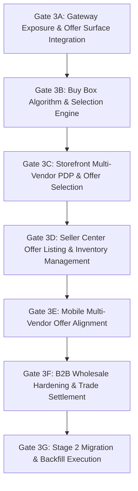

# MUNZI — STAGE 3: MARKETPLACE EXPANSION & INTEGRATION READINESS
## Comprehensive Technical Audit, Architectural Assessment, and Engineering Roadmap

**Document Version:** 1.0.0  
**Audit Date:** November 21, 2026  
**Auditor:** Principal Architect & Lead Engineering Auditor  
**Codebase:** `c:\PROJECTS\Code\Munzi`  
**Target File:** `stage-3-assessment-and-roadmap.md`

---

## 1. EXECUTIVE SUMMARY

An exhaustive, non-destructive audit and reverse-engineering assessment was performed on the MUNZI repository to determine the true state of the platform following the reported completion of Stage 2 (Catalogue Foundation, Product Offers, Multi-Vendor Cart, and Checkout Integration). Every module across backend microservices, database schemas, messaging buses, API gateway routes, frontend applications, and mobile clients was examined against raw source files, Git commit history, and test executions.

### Key Audit Findings

1. **Stage 2 Primitives Exist in Backend Core, But Are Cut Off at the Edges:**  
   The underlying backend services (`product-service`, `inventory-service`, `cart-service`, `checkout-service`, and `order-service`) contain verified, working logic for canonical products, hierarchical variants, `ProductOffer` models, offer-aware reservations, multi-vendor cart grouping, checkout sagas, and suborder splitting. All 283 unit tests in `product-service`, 70 in `cart-service`, 140 in `checkout-service`, and 81 in `order-service` pass cleanly.
2. **The Buy Box is Completely Non-Functional (Hardcoded Stub):**  
   While the schema includes `isBuyBoxWinner: Boolean`, there is **zero algorithmic evaluation** or winner selection logic. Every offer is written with `isBuyBoxWinner: false`. Consequently, storefront queries sort offers by `[{ isBuyBoxWinner: 'desc' }, { price: 'asc' }]`, which defaults entirely to linear price ordering.
3. **Database Migrations and Backfills Remain Strictly Unapplied:**  
   Prisma migration `20261115010000_product_offer_foundation` in `product-service` is explicitly commented as `-- Status: PREPARED ONLY — STRICTLY UNAPPLIED.` The deterministic backfill script (`backfill.service.ts`) has only ever executed inside Jest unit mocks; it has never executed against a live database.
4. **API Gateway Omits ProductOffer Routing:**  
   The API Gateway (`backend/api-gateway/src/routes/customer.routes.ts` and `seller.routes.ts`) contains zero route definitions for `/offers`, `/offers/:id`, `/offers/:id/quarantine`, or `/sellers/:sellerId/offers`. Frontends calling these endpoints through the gateway receive HTTP 404.
5. **Frontend Applications Suffer from Complete Disconnect:**  
   Neither `customer-web`, `seller-center`, nor `mobile` integrate with `ProductOffer`.
   - `customer-web`'s Product Detail Page (`ProductDetailPage.tsx`) queries only `/products/:id/variants` from the original single-seller listing.
   - `WholesaleCheckoutPage.tsx` is an entirely mock, non-functional component displaying a hardcoded "Samsung Galaxy S24 Ultra" with no backend API submission.
   - `seller-center` still imports mock product pools in campaign management and offers no UI for listing competing offers against existing canonical products.
   - `mobile` (React Native/Expo) has zero references to `ProductOffer`.
6. **Cross-Service Database Violations & Inconsistencies:**  
   `inventory-service` connects directly to `product-service`'s PostgreSQL database (`muni_products`), violating microservice bounded contexts. Furthermore, its Prisma schema defines an incompatible `ProductCondition` enum (`LIKE_NEW` vs `USED_LIKE_NEW`).
7. **Four-Platform Hybrid Vision Asymmetry:**  
   - **Amazon B2C:** Strong backend foundations (canonical products, variants, offers, suborders, split fulfillment), but lacks Buy Box selection, gateway exposure, and frontend integration.
   - **Jumia Africa-First:** Complete local payment drivers (MTN MoMo, Airtel Money) and PUDO pickup network models, but incomplete COD remittance/reconciliation and rider settlement.
   - **eBay C2C / Auctions:** **Not started** (0 auction lines, 0 bidding engine, 0 anti-sniping code). P2P negotiation exists only as an isolated chat widget in `chat-service`.
   - **Alibaba B2B Wholesale:** Partial tier pricing, but **0 RFQ code**, 0 trade assurance, and the backend wholesale service (`wholesale.service.ts`) relies on an **in-memory JavaScript `Map`** and hardcoded discount tiers.
8. **Polyglot Reality:**  
   No Go code exists in the repository. Four services contain duplicate Python FastAPI prototypes (`user-service`, `currency-service`, `analytics-service`, `recommendation-service`) that are completely ignored by `docker-compose.yml`, which runs their TypeScript versions.

---

## 2. ACTUAL VERIFIED STAGE 2 STATUS

The user request instructed an independent inspection of Stage 2 gates: **2A, 2B, 2C.1, 2C.2, 2C.3, and 2C.4**.

| Stage 2 Gate | Status | Reality Verified Against Implementation |
|---|---|---|
| **2A — Catalogue Foundation & Product Models** | **Complete & Verified** | Category tree self-relations with cycle detection (`category.service.ts`), typed `CategoryAttribute` variant combinations (`category-attribute.service.ts`), product status moderation (`PENDING_APPROVAL`, rejection reasons, admin attribution). 283 unit tests passing. |
| **2B — Catalogue Logic and API** | **Complete & Verified** | Full CRUD for products and variants with slug collision avoidance (`product.service.ts`), active variant price aggregation (`minVariantPrice`), wholesale tier validation (`validateWholesaleTiers`). Elasticsearch hooks with graceful fallback. |
| **2C.1 — ProductOffer Schema & Backfill Preparation** | **Partial (Prepared, Unapplied)** | Schema defined in `product-service/prisma/schema.prisma` with foreign key cascades and composite keys. Migration file `20261115010000_product_offer_foundation` created but **unapplied**. Backfill service (`backfill.service.ts`) written and unit-tested with dry-run support, but never executed on live DB. |
| **2C.2 — ProductOffer Services and API** | **Partial (Code Complete, Edge Blocked)** | Complete service methods in `offer.service.ts` for offer lifecycle, pricing, and seller eligibility. **Crucial gaps:** (1) `isBuyBoxWinner` is never computed (hardcoded `false`); (2) API gateway completely lacks routes for standalone `/offers` endpoints. |
| **2C.3 — Offer-Based Inventory Integration** | **Partial (Code Complete, Architecture Flawed)** | `reservation.service.ts` in `inventory-service` supports offer stock reservations, atomic increments, and BullMQ expiry sweeps. **Crucial gaps:** (1) Direct database coupling to `muni_products`; (2) Incompatible `ProductCondition` enum in Prisma schema; (3) Integration tests fail in sandboxed loopback environments. |
| **2C.4 — Multi-Vendor Cart & Checkout Integration** | **Partial (Backend Ready, UI Disconnected)** | Cart service validates offers and groups items by seller. Checkout saga coordinates 2-phase commits: reservations -> payment authorization -> suborder creation (`order-service`) -> inventory deduction -> cart clear. **Crucial gap:** Zero frontend integration; clients still submit single-seller variant carts. |

### Detailed Defect & Safety Findings in Stage 2 Code

1. **Unapplied Migration:**  
   File: [migration.sql](file:///c:/PROJECTS/Code/Munzi/backend/services/product-service/prisma/migrations/20261115010000_product_offer_foundation/migration.sql#L1-L15)  
   Contains explicit header: `-- Status: PREPARED ONLY — STRICTLY UNAPPLIED.` If a deployment starts without running this migration, any query referencing `ProductOffer` or `minOfferPrice` crashes with `relation "ProductOffer" does not exist`.
2. **Missing Gateway Endpoints:**  
   In [customer.routes.ts](file:///c:/PROJECTS/Code/Munzi/backend/api-gateway/src/routes/customer.routes.ts#L100-L125) and [seller.routes.ts](file:///c:/PROJECTS/Code/Munzi/backend/api-gateway/src/routes/seller.routes.ts#L15-L25):  
   The gateway exposes `/products`, `/categories`, and `/brands` to `targets.product`. However, `product-service` routes for `GET /api/v1/offers/:id`, `PATCH /api/v1/offers/:id`, `DELETE /api/v1/offers/:id`, `POST /api/v1/offers/:id/quarantine`, and `GET /api/v1/sellers/:sellerId/offers` are not mounted. Any client calling them receives 404.
3. **Checkout Reversal Edge Case (Fixed in Working Copy):**  
   In [checkout.service.ts](file:///c:/PROJECTS/Code/Munzi/backend/services/checkout-service/src/services/checkout.service.ts#L208-L225):  
   When a payment fails or times out, the release path originally checked only `${SERVICES.inventory}/api/v1/inventory/${hold.variantId}/release`. The working tree modification correctly routes offer holds to `/api/v1/inventory/offers/${hold.offerId}/release`. This uncommitted change must be preserved and tested.
4. **Shared Database Anti-Pattern:**  
   In [inventory-service/prisma/schema.prisma](file:///c:/PROJECTS/Code/Munzi/backend/services/inventory-service/prisma/schema.prisma#L3-L15):  
   The comment explicitly admits: `"THIS SERVICE DOES NOT OWN THESE TABLES. product-service does. inventory-service reads and writes stock on product-service's database."` This violates service isolation, risks concurrent migration deadlocks, and prevents independent scaling of catalogue and warehouse databases.

---

## 3. FOUR-PLATFORM CAPABILITY COMPARISON

MUNZI’s core architectural vision blends four global marketplace paradigms. The table below provides an evidence-based assessment of every specific capability derived from these platforms.

| Platform Reference | Marketplace Capability | Implementation Status | Repository Evidence & Analysis |
|---|---|---|---|
| **Amazon** | **Buy Box Algorithm** | **Missing** | `isBuyBoxWinner` exists as a DB boolean but is never awarded. No score calculation combining price, seller rating, shipping time, and defect rate exists. |
| **Amazon** | **Multiple Competing Offers** | **Partial** | Backend schema, offer CRUD, and cart grouping exist. Completely absent from API gateway routing, customer web PDP, and seller center listing tools. |
| **Amazon** | **Product Variations & Discovery** | **Complete** | Full hierarchical variant attributes, multi-axis combinations, and category attribute templates implemented in `product-service`. |
| **Amazon** | **Seller vs Platform Fulfillment** | **Partial** | `fulfillment-service` and `shipping-service` model carrier drop-off and rider assignments, but automated FBA-style platform warehousing allocation is not built. |
| **Amazon** | **Split Shipments & Suborders** | **Complete** | Checkout and Order service split orders into vendor-specific `SubOrder` records with distinct fulfillment IDs and status transitions. |
| **Amazon** | **Seller Performance Metrics** | **Partial** | `seller-center` contains a scorecard API, but it historically relied on mock data; automated suspension based on order defect rates (ODR) is unlinked. |
| **Jumia** | **Mobile Money (MTN / Airtel)** | **Complete** | Production drivers in `payment-service/src/drivers/mtn-momo.driver.ts` and `airtel-money.driver.ts` with webhook signatures, idempotency, and push prompts. |
| **Jumia** | **Cash on Delivery (COD)** | **Partial** | `cod` payment method accepted in checkout; rider parcel collection tracking exists in `fulfillment-service/src/controllers/cod.controller.ts`. **Missing:** End-of-day courier cash deposit reconciliation and remitted bank matching. |
| **Jumia** | **Pickup Stations (PUDO)** | **Complete** | Full relational model in `shipping-service` (`pickup_stations`, `package_holds`) with human code generators (`PUDO-KLA-001`) and hash-verified pickup PINs. |
| **Jumia** | **Vendor Drop-Off** | **Partial** | Hub intake logic modeled in `fulfillment-service`, but self-service vendor drop-off kiosk scanning and barcode generation are not exposed in seller center. |
| **Jumia** | **Mobile Commerce Experience** | **Partial** | React Native Expo application exists in `mobile/`, but it has not been upgraded to Stage 2 multi-vendor offers. |
| **eBay** | **Auctions & Bidding Engine** | **Missing** | **Zero auction code.** No bidding tables, no bid placement endpoints, no concurrency sequencing. |
| **eBay** | **Proxy Bidding** | **Missing** | Not implemented. |
| **eBay** | **Reserve Price & Min Increments** | **Missing** | Not implemented. |
| **eBay** | **Anti-Sniping Clock Extensions** | **Missing** | Not implemented. |
| **eBay** | **Best Offer / Price Negotiation** | **Partial** | Implemented solely inside `chat-service` (`src/models/offer.model.ts`) as private buyer-seller chat counter-offers; completely disconnected from the public catalogue. |
| **eBay** | **Used Product Grading** | **Partial** | `ProductCondition` enum exists on Product and Offer (`NEW`, `REFURBISHED`, `USED_LIKE_NEW`, `USED_GOOD`, `USED_FAIR`, `FOR_PARTS`), but photo grading criteria and buyer condition guarantees are missing. |
| **eBay** | **Dispute & Buyer Protection** | **Complete** | Dedicated `dispute-service` and `buyer-protection-service` with escrow freezing, evidence submission, and admin claim resolution. |
| **Alibaba** | **Tiered Wholesale Pricing** | **Partial** | `wholesaleTiers` JSON column exists on Product and Offer; Cart and Checkout dynamically apply volume unit discounts. |
| **Alibaba** | **Wholesale B2B Workflow** | **Blocked / Broken** | `order-service/src/services/wholesale.service.ts` uses an **in-process `new Map()`**, hardcoded discount bands (1-9: 0%, 10-49: 10%), and `customer-web/WholesaleCheckoutPage.tsx` is a non-functional mock. |
| **Alibaba** | **Minimum Order Quantity (MOQ)** | **Partial** | `moq` column exists on Product and Offer; enforced in `cart-service`, but missing wholesale checkout gating and seller minimum policy overrides. |
| **Alibaba** | **RFQs & Supplier Quotations** | **Missing** | **Zero RFQ code.** No buyer request board, no supplier quote submission, no bid comparison. |
| **Alibaba** | **Trade Assurance & Milestones** | **Partial** | Standard single-release escrow exists in `payment-service`, but milestone disbursements (e.g. 30% advance, 70% post-inspection) do not exist. |
| **Alibaba** | **Incoterms & Customs Docs** | **Missing** | No fields or services for FOB, CIF, EXW, commercial invoices, or packing lists. |

---

## 4. FULL REPOSITORY AUDIT

### 4.1 Backend Services and API Gateway Architecture

The platform consists of **35 backend services** (34 microservices + 1 API gateway) written primarily in TypeScript/Node.js with Express and Prisma/Mongoose.

```
MUNZI Architecture Footprint:
├── backend/
│   ├── api-gateway/              (Express reverse proxy, JWT strip/stamp, rate-limiting)
│   ├── infrastructure/           (Kafka, RabbitMQ, Redis, Kubernetes, Monitoring)
│   ├── migrator/                 (Dockerized Prisma migration deployment runner)
│   ├── shared/                   (Cross-service types, Kafka producers, S3 storage client)
│   └── services/                 (34 microservices)
│       ├── Core Transactional:   auth, product, inventory, cart, checkout, order, payment
│       ├── Logistics & Fulfil:   shipping, fulfillment, container
│       ├── Customer Care/Trust:  dispute, buyer-protection, return, review, qa, support, chat
│       ├── Marketing/Discovery:  search, recommendation, analytics, advertising, discount, newsletter
│       ├── Financial/Operations: currency, tax, pricing, loyalty, marketplace, seller-education
│       └── Supporting Services:  media, fraud, wishlist, user
```

### 4.2 Incomplete Integrations, Dead Code, and Architectural Risks

1. **Dead/Duplicate `search-service`:**  
   `search-service` runs Elasticsearch and defines its own indexing logic. However, the API Gateway (`customer.routes.ts`, lines 104-123) **explicitly bypasses `search-service`** and routes `/search` directly to `product-service`. As noted in the gateway comments:
   > *"This pointed at search-service, and both services were writing the SAME index (`muni-products`) with DIFFERENT mappings... search-service seeded 12 invented demo products into that index on boot... One writer, one reader, one mapping. product-service already exposes GET /api/v1/search."*  
   `search-service` is dead weight in `docker-compose.yml`, consuming memory and disk while remaining unreachable to customers.
2. **Volatile In-Memory Wholesale Store in `order-service`:**  
   In [wholesale.service.ts](file:///c:/PROJECTS/Code/Munzi/backend/services/order-service/src/services/wholesale.service.ts#L41):  
   `const wholesaleOrdersStore = new Map<string, WholesaleOrder>();`  
   Wholesale orders placed through this endpoint are stored in Node.js process heap memory. A pod restart destroys all wholesale orders, and orders do not synchronize with MongoDB or `subOrders`.
3. **Dual Messaging Stack (Kafka vs RabbitMQ Confusion):**  
   The codebase contains dual message bus implementations:
   - `order-service` publishes to Kafka (`order-events`) AND RabbitMQ (`order.created`).
   - `inventory-service` runs an `order-rabbitmq.consumer.ts` AND connects to Kafka.
   - `payment-service` listens to Kafka (`payment-service-order-group`).  
   Having two message brokers active across services introduces split-brain messaging, duplicate event handling, and operational fragility.
4. **Mocked and Disconnected Frontend Screens:**  
   - `frontend/customer-web/src/pages/WholesaleCheckoutPage.tsx`: Hardcoded prototype. Cannot submit an order.
   - `frontend/seller-center/src/components/advertising/CampaignBuilder.tsx`: Imports `PRODUCT_POOL` from `@/mocks/campaigns.mock`.
   - `frontend/customer-web/src/pages/ProductDetailPage.tsx`: Completely ignores `ProductOffer` and queries only legacy variants.
   - `frontend/admin-panel/src/components/verification/DocumentInspectionDrawer.tsx`: Imports mock document types from `@/mocks/sellers.mock`.

---

## 5. POLYGLOT ARCHITECTURE REVIEW

### 5.1 Analysis of TypeScript, Python, and Go Reality

The original project vision proposed a polyglot architecture:
- TypeScript/Node.js: Core marketplace, transactional APIs, Gateway.
- Python: Analytics, recommendations, pricing intelligence, fraud detection.
- Go: Concurrency-heavy workloads, real-time auctions, worker threads.

### 5.2 Real Codebase Verification

| Language | Real Footprint in Repo | Services Containing It | Assessment & Recommendation |
|---|---|---|---|
| **TypeScript / Node.js** | **98% of active codebase** | All 35 services, API Gateway, and frontends. | **Retain 100%.** Transactional services, Prisma ORM mappings, Zod schemas, and Jest suites are mature, tested, and reliable. Do not rewrite. |
| **Python** | **Isolated prototypes** | `analytics-service`, `currency-service`, `recommendation-service`, `user-service`. | **Split-Brain Maintenance.** In `user-service` and `currency-service`, Python code simply duplicates standard CRUD APIs that are already written in TypeScript. However, `recommendation-service` and `analytics-service` genuinely benefit from Python's ML libraries (`numpy`, `scipy`, `scikit-learn`). **Action:** Decommission Python in `user-service` and `currency-service`; retain and formalize Python exclusively for ML/Analytics services if containerized separately. |
| **Go** | **0% (Zero files, zero modules)** | None. | **Do not prematurely introduce.** Go is not needed for current retail workloads. When eBay-style real-time auctions are built in Stage 6, a standalone Go service for the auction bid sequencing engine will be justified by sub-millisecond concurrency requirements. |

---

## 6. DATABASE AND FINANCIAL SAFETY

### 6.1 Database Architecture & Ownership Violations

1. **Prisma Multi-Service Cross-Mount:**  
   `product-service` and `inventory-service` share the `muni_products` PostgreSQL database. `inventory-service/prisma/schema.prisma` is a manually maintained partial mirror.
   - **Risk:** Any migration executed in `product-service` that alters variant or reservation columns risks immediately breaking `inventory-service` queries.
   - **Enum Drift:** `ProductCondition` in `product-service` has values `[NEW, REFURBISHED, USED_LIKE_NEW, USED_GOOD, USED_FAIR, OPEN_BOX, FOR_PARTS]`. In `inventory-service`, it is defined as `[NEW, LIKE_NEW, REFURBISHED, USED_EXCELLENT, USED_GOOD, USED_FAIR]`. If `inventory-service` reads an `OPEN_BOX` or `USED_LIKE_NEW` offer, Prisma Client throws a runtime validation error.
2. **MongoDB in `order-service`:**  
   Orders and suborders are stored in MongoDB via Mongoose (`muni_orders`), while payments and ledger entries are stored in PostgreSQL (`muni_payment`).
   - **Risk:** Cross-database transactions do not exist. A network partition between checkout completion and order persistence requires careful 2-phase saga compensation.

### 6.2 Financial Flows, Ledgers, and Escrow Safety

1. **Decimal Precision:**  
   `payment-service` correctly enforces PostgreSQL `DECIMAL(18, 4)` for all currency calculations, and `product-service` enforces `DECIMAL(12, 2)`. This prevents binary floating-point rounding errors.
2. **Escrow Lifecycle:**  
   In [escrow.service.ts](file:///c:/PROJECTS/Code/Munzi/backend/services/payment-service/src/services/escrow.service.ts#L193-L295):
   - Escrow holds are created per suborder (`EscrowHold` table).
   - `releaseEscrow()` releases vendor payout only upon delivery confirmation (`order.delivered` / `order.sub_order_updated` status = `delivered`).
   - `refundEscrow()` correctly resolves frozen funds back to buyers upon dispute resolution.
3. **Idempotency and Concurrency:**  
   - `checkout-service` utilizes Redis-backed locks (`sessionRepository.acquireLock`) with a 30-second TTL to prevent concurrent checkouts of the same session.
   - `idempotency.middleware.ts` enforces unique `Idempotency-Key` headers on payment and checkout endpoints.
4. **Cash on Delivery (COD) Financial Risk:**  
   While `fulfillment-service` records rider cash collection, there is **no double-entry ledger** recording courier liability, physical cash handovers at the hub, or bank deposit reconciliation. If a courier absconds with cash, the system reflects the order as `delivered` and credits the seller, creating an irrecoverable platform loss.

---

## 7. DETERMINE STAGE 3: MARKETPLACE EXPANSION & INTEGRATION READINESS

Stage 3 must **not** attempt to build unstarted paradigms (such as eBay auctions or Alibaba RFQs) before the multi-vendor core built in Stage 2 is exposed, tested, and operationalized.

Stage 3 is organized into **seven sequential, independently reviewable gates**.



---

### GATE 3A: Gateway Exposure & Offer Surface Integration

- **Objective:** Expose `ProductOffer` endpoints through the API Gateway with proper authentication, role enforcement, and input sanitization.
- **Business Value:** Enables external clients (seller dashboard, customer storefront, mobile app) to query and manage multi-vendor offers.
- **Existing Dependencies:** Stage 2C.2 `offer.controller.ts` in `product-service`.
- **Exact Scope:**
  - Mount `/offers` and `/products/:id/offers` in `backend/api-gateway/src/routes/customer.routes.ts` (public read-only) and `seller.routes.ts` (seller authenticated writes).
  - Strip client identity headers and inject verified `x-user-id` and `x-user-roles`.
  - Fix working tree uncommitted bug in `backend/services/checkout-service/src/services/checkout.service.ts` (releasing offer-based holds).
- **Files/Services Affected:**
  - `backend/api-gateway/src/routes/customer.routes.ts`
  - `backend/api-gateway/src/routes/seller.routes.ts`
  - `backend/api-gateway/src/routes/admin.routes.ts`
  - `backend/services/checkout-service/src/services/checkout.service.ts`
- **Required Tests:**
  - Gateway proxy integration tests verifying anonymous GET `/products/:id/offers` succeeds.
  - Gateway security tests verifying unauthenticated POST/PATCH `/offers` returns 401.
  - Gateway authorization tests verifying seller A cannot PATCH seller B’s offer (403/404).
- **Security & Financial Risks:** Risk of exposing internal administrative offer quarantine endpoints if not strictly gated to `ROLE_ADMIN`.
- **Exit Criteria:**
  - `curl http://localhost:4000/api/v1/products/:id/offers` resolves to `product-service` without 404.
  - Identity headers are stripped and validated by gateway middleware.
- **What Must NOT Be Done:** Do not alter the database schema or write frontend UI.

---

### GATE 3B: Buy Box Algorithm & Selection Engine

- **Objective:** Replace the hardcoded `isBuyBoxWinner: false` stub with an automated Buy Box evaluation algorithm.
- **Business Value:** Replicates Amazon's primary conversion mechanism: presents the best offer (price, stock, delivery speed, seller rating) as the default purchase choice for buyers.
- **Existing Dependencies:** Gate 3A; `offer.service.ts` in `product-service`.
- **Exact Scope:**
  - Implement `evaluateBuyBox(productId: string, tx?: PrismaClient)` in `product-service`.
  - Scoring factors:
    1. Landed price (unit price + estimated standard shipping).
    2. In-stock availability (`stock - reserved > 0`).
    3. Seller trust score (from `sellerEligibilityService` / `user-service`).
    4. Condition priority (`NEW` preferred over `REFURBISHED` for default Buy Box).
  - Automatically promote the top-scoring offer to `isBuyBoxWinner: true` and demote competing offers to `false` in a single transaction.
  - Trigger Buy Box re-evaluation upon: offer creation, price update, stock decrement, or seller status change.
- **Files/Services Affected:**
  - `backend/services/product-service/src/services/offer.service.ts`
  - `backend/services/product-service/src/services/buybox.service.ts` (new service module)
  - `backend/services/product-service/src/controllers/offer.controller.ts`
- **Required Tests:**
  - Unit tests verifying lowest priced eligible seller wins Buy Box.
  - Out-of-stock winner demotion test: when winner stock drops to 0, second-best seller is promoted.
  - Seller suspension test: when seller eligibility is revoked, offer loses Buy Box immediately.
- **Security & Financial Risks:** Flawed scoring could allow fraudulent or unverified sellers to hijack the Buy Box.
- **Exit Criteria:**
  - Every active canonical product with eligible offers has exactly one `isBuyBoxWinner: true` offer.
  - Test suite passes with 100% deterministic winner selection.
- **What Must NOT Be Done:** Do not introduce dynamic repricer bots or off-platform scraping.

---

### GATE 3C: Storefront Multi-Vendor PDP & Offer Selection

- **Objective:** Upgrade `customer-web` Product Detail Page to display the Buy Box winner, multi-seller offer comparison table, and allow shoppers to select alternative seller offers.
- **Business Value:** Shoppers can compare multiple sellers offering the same canonical product, choosing between lowest price, fastest delivery, or preferred seller condition.
- **Existing Dependencies:** Gate 3A, Gate 3B, `customer-web/src/api/products.api.ts`.
- **Exact Scope:**
  - Add `getOffers(productId: string)` to `frontend/customer-web/src/api/products.api.ts`.
  - Refactor [ProductDetailPage.tsx](file:///c:/PROJECTS/Code/Munzi/frontend/customer-web/src/pages/ProductDetailPage.tsx):
    - Highlight Buy Box winner in primary "Add to Cart" box.
    - Render "Other Sellers on Muni" accordion/drawer comparing price, condition, seller rating, and shipping time.
  - Update `useCart` hook to pass `offerId` and `sellerId` when adding items to cart.
- **Files/Services Affected:**
  - `frontend/customer-web/src/api/products.api.ts`
  - `frontend/customer-web/src/pages/ProductDetailPage.tsx`
  - `frontend/customer-web/src/components/product/ProductOffersList.tsx` (new component)
  - `frontend/customer-web/src/components/product/ProductDetails.tsx`
  - `frontend/customer-web/src/hooks/useCart.ts`
- **Required Tests:**
  - React Testing Library tests for PDP: verifies Buy Box winner renders by default.
  - Offer selection test: verifies clicking "Buy from Seller B" updates cart payload with Seller B's `offerId`.
- **Security & Financial Risks:** Price tampering in client-side state (mitigated by checkout-service server-side price validation).
- **Exit Criteria:**
  - End-to-end PDP browsing displays multiple sellers for a canonical product.
  - Cart payload contains verified `offerId`.
- **What Must NOT Be Done:** Do not rewrite checkout or cart backend logic.

---

### GATE 3D: Seller Center Offer Listing & Inventory Management

- **Objective:** Enable sellers in `seller-center` to search canonical products and list competing offers against existing ASINs/products without creating duplicate listings.
- **Business Value:** Prevents catalogue pollution (Amazon 1-product-many-sellers model), increases marketplace price competition, and speeds up seller listing workflow.
- **Existing Dependencies:** Gate 3A, Gate 3B; `seller-center/src/api`.
- **Exact Scope:**
  - Create `offers.api.ts` in `frontend/seller-center/src/api`.
  - Build "List Against Existing Product" search flow in `seller-center`:
    - Seller searches catalogue by barcode/SKU/name.
    - Seller inputs: Price, Compare-at Price, Condition, Stock, Low-stock threshold, and Wholesale Tiers.
    - Submits to `POST /api/v1/products/:id/offers`.
  - Add "My Offers" tab in Seller Center inventory management.
- **Files/Services Affected:**
  - `frontend/seller-center/src/api/offers.api.ts` (new)
  - `frontend/seller-center/src/pages/InventoryPage.tsx`
  - `frontend/seller-center/src/pages/OfferCreatePage.tsx` (new)
  - `frontend/seller-center/src/components/inventory/OfferTable.tsx` (new)
- **Required Tests:**
  - Unit tests for offer creation form: validates price > 0, stock >= 0.
  - Permission test: verifies sellers can only edit their own offers.
- **Security & Financial Risks:** Malicious sellers listing negative prices or hijacking branded SKUs.
- **Exit Criteria:**
  - Sellers can list an offer on an existing canonical product in < 60 seconds without creating a new product record.
- **What Must NOT Be Done:** Do not allow unverified (KYC pending) sellers to activate live offers.

---

### GATE 3E: Mobile Multi-Vendor Offer Alignment

- **Objective:** Align the React Native / Expo mobile application with Stage 2 and Stage 3 offer capabilities.
- **Business Value:** Extends multi-vendor shopping, competitive pricing, and offer selection to mobile users (critical for Uganda/African smartphone-first demographic).
- **Existing Dependencies:** Gate 3A, Gate 3B, Gate 3C; `mobile/src/api`.
- **Exact Scope:**
  - Update `mobile/src/types/index.ts` to include `ProductOffer`.
  - Update `mobile/src/api/products.api.ts` with `getProductOffers(productId)`.
  - Update `ProductCard` and `ProductDetailScreen` in `mobile/src/screens` to display Buy Box price and "X offers from UGX Y".
  - Update `cart.slice.ts` in Redux to store `offerId` and dispatch offer-aware checkout sessions.
- **Files/Services Affected:**
  - `mobile/src/types/index.ts`
  - `mobile/src/api/products.api.ts`
  - `mobile/src/screens/ProductDetailScreen.tsx`
  - `mobile/src/store/cart.slice.ts`
  - `mobile/src/components/ProductCard.tsx`
- **Required Tests:**
  - Jest mobile component tests for `ProductDetailScreen` with multiple offers.
  - Cart slice reducer tests verifying `offerId` retention and quantity limits.
- **Security & Financial Risks:** App crashes on legacy products lacking offers (requires null-safe fallbacks).
- **Exit Criteria:**
  - Mobile app builds successfully on Expo; PDP displays competing offers; checkout succeeds with `offerId`.
- **What Must NOT Be Done:** Do not rewrite payment drivers or introduce mobile-only bidding.

---

### GATE 3F: B2B Wholesale Hardening & Trade Settlement

- **Objective:** Eradicate the in-memory map in `order-service/wholesale.service.ts` and replace the mock `WholesaleCheckoutPage.tsx` with a production B2B order flow.
- **Business Value:** Legitimizes MUNZI's Alibaba-inspired wholesale proposition for Ugandan bulk traders and institutional buyers.
- **Existing Dependencies:** Gate 3A, Gate 3D; `order-service`, `customer-web`.
- **Exact Scope:**
  - Remove `const wholesaleOrdersStore = new Map()` in `backend/services/order-service/src/services/wholesale.service.ts`.
  - Persist wholesale orders in MongoDB (`muni_orders`) as formal `Order` and `SubOrder` records flagged with `type: 'WHOLESALE'`.
  - Dynamically read seller-defined `wholesaleTiers` from `product-service` rather than using hardcoded percentage bands.
  - Rewrite [WholesaleCheckoutPage.tsx](file:///c:/PROJECTS/Code/Munzi/frontend/customer-web/src/pages/WholesaleCheckoutPage.tsx) to accept real product IDs, calculate dynamic volume discounts, and submit pro-forma order requests to the backend.
- **Files/Services Affected:**
  - `backend/services/order-service/src/services/wholesale.service.ts`
  - `backend/services/order-service/src/models/order.model.ts`
  - `backend/services/order-service/src/models/order.schema.ts`
  - `frontend/customer-web/src/pages/WholesaleCheckoutPage.tsx`
  - `frontend/customer-web/src/api/wholesale.api.ts` (new)
- **Required Tests:**
  - Unit tests in `order-service` verifying wholesale orders persist across service restarts.
  - Tier volume threshold test: ordering 50 units receives exact tier pricing from product catalogue.
- **Security & Financial Risks:** Unauthenticated callers placing massive bogus wholesale reservations that lock inventory.
- **Exit Criteria:**
  - Wholesale orders are persisted in MongoDB.
  - Zero in-memory Maps remain in `order-service`.
  - Pro-forma invoices generate valid order IDs.
- **What Must NOT Be Done:** Do not build full Alibaba-style RFQ quotation boards in this gate.

---

### GATE 3G: Stage 2 Migration & Backfill Execution

- **Objective:** Safely apply Prisma migration `20261115010000_product_offer_foundation` to the staging/production database and execute `reconcileLegacyToOffers()` with zero downtime.
- **Business Value:** Converts all historical single-seller catalogue listings into multi-vendor canonical products and offers, completing Stage 2 data transition.
- **Existing Dependencies:** Gate 3A through 3F fully verified.
- **Exact Scope:**
  - Create a safe CLI migration runner script (`backend/services/product-service/scripts/run-stage2-migration.ts`).
  - Execute Prisma migration deploy against `muni_products`.
  - Run `runCatalogueBackfill({ dryRun: true })` and verify summary report.
  - Run `runCatalogueBackfill({ dryRun: false })` with quarantine of invalid/unverified listings.
  - Execute `reconcileLegacyToOffers()` and assert `report.isParityConfirmed === true`.
- **Files/Services Affected:**
  - `backend/services/product-service/prisma/migrations/20261115010000_product_offer_foundation/`
  - `backend/services/product-service/src/services/backfill.service.ts`
  - `backend/migrator/migrate.sh`
- **Required Tests:**
  - Pre-migration database backup and verification.
  - Parity reconciliation test: 100% of existing variants have corresponding active offers.
  - Zero-drift stock audit: `ProductVariant.stock` matches `ProductOffer.stock`.
- **Security & Financial Risks:** Data loss or catalogue unavailability during table lock.
- **Exit Criteria:**
  - `migration_lock.toml` updated; all migrations applied.
  - `isParityConfirmed: true` returned by backfill reconciler.
- **What Must NOT Be Done:** Do not drop legacy `ProductVariant` columns until Stage 4 (backward compatibility required).

---

## 8. LATER-STAGE ROADMAP BEYOND STAGE 3

To prevent scope creep and maintain architectural discipline, capabilities from the 4 reference platforms that are not part of Stage 3 are scheduled into subsequent stages:

```
┌────────────────────────────────────────────────────────────────────────┐
│                        MUNZI COMPLETION PHASES                         │
├──────────────┬───────────────────────────────────────────┬─────────────┤
│ Phase        │ Focus & Core Capabilities                 │ Platform    │
├──────────────┼───────────────────────────────────────────┼─────────────┤
│ Stage 3      │ Marketplace Expansion & Integration       │ Amazon/Core │
│ Stage 4      │ Logistics, PUDO & COD Financial Safety    │ Jumia       │
│ Stage 5      │ B2B Wholesale, RFQs & Trade Assurance     │ Alibaba     │
│ Stage 6      │ Real-Time Auctions & C2C Bidding (Go)     │ eBay        │
│ Stage 7      │ Production Hardening, Audit & Go-Live     │ Enterprise  │
└──────────────┴───────────────────────────────────────────┴─────────────┘
```

- **Stage 4 — Logistics, PUDO & COD Financial Safety (Jumia Focus):**
  - Courier cash collection reconciliation and double-entry remittance ledger.
  - Self-service PUDO locker integration and dispatch routing.
  - Automated carrier SLA scoring and failed delivery recovery.
- **Stage 5 — B2B Wholesale, RFQ Board & Trade Assurance (Alibaba Focus):**
  - Buyer RFQ post and supplier quotation bid comparison system.
  - Milestone-based multi-stage escrow release (e.g. 30% deposit, 70% delivery).
  - Business buyer enterprise verification and tax exemption certificates.
  - Incoterms, packing slips, and pro-forma invoice generator.
- **Stage 6 — Real-Time Auctions & C2C Bidding (eBay Focus):**
  - Greenfield **Go** service (`auction-service`) for high-concurrency bid sequencing.
  - Proxy bidding, reserve price enforcement, and anti-sniping clock extensions.
  - Used product photo condition grading checklists and verification guarantees.
- **Stage 7 — Production Hardening, Security & Go-Live:**
  - Decommissioning dead `search-service` and consolidating Elasticsearch.
  - Multi-region database replication in AWS `af-south-1`.
  - Comprehensive external penetration testing and PCI-DSS compliance verification.

---

## 9. REMAINING WORK ESTIMATE & COMPLETION CLASSIFICATIONS

The table below breaks down the readiness of each major domain of MUNZI. Arbitrary percentages are avoided in favor of strict engineering maturity tiers.

| Subsystem / Domain | Implementation Status | Integration Status | Test Readiness | Production Readiness |
|---|---|---|---|---|
| **Identity & Authentication (Auth, JWT, MFA)** | Complete | Complete | High (Unit/E2E pass) | **Staging-Ready** |
| **Product Catalogue & Variants (Stage 2A/2B)** | Complete | Complete | High (283 tests pass) | **Staging-Ready** |
| **ProductOffer & Multi-Vendor Core (Stage 2C)** | Complete in backend | Incomplete at Gateway/UI | Medium (Backend passed, UI 0%) | **Feature-Complete Only** |
| **Buy Box Selection Algorithm** | Missing | Missing | Not Started | **Not Started** |
| **Multi-Vendor Cart & Checkout Saga** | Complete in backend | Disconnected from Web/Mobile | High (140 tests pass) | **Integration-Incomplete** |
| **Orders & Suborder Splitting** | Complete in backend | Complete with Payment/Fulfil | High (81 tests pass) | **Staging-Ready** |
| **Payment Gateway (MTN, Airtel, Visa 3DS)** | Complete (Real Drivers) | Complete with Webhooks | High (Unit tests pass) | **Staging-Ready** (Needs Live Keys) |
| **Escrow & Settlement Ledger** | Complete | Complete with Orders | High (Reconciliation tested)| **Staging-Ready** |
| **Logistics, Shipping & PUDO Stations** | Complete | Complete with Fulfillment | High (Tariffs tested) | **Staging-Ready** |
| **Cash on Delivery (COD) Reconciliation** | Partial (Collection only) | Incomplete (No Bank Remit) | Low | **Not Production-Ready** |
| **B2B Wholesale & MOQ** | Partial (Prototype/In-Mem) | Disconnected (Mock UI) | Low | **Not Production-Ready** |
| **Auctions & Bidding Engine (eBay)** | Not Started (0%) | Not Started | Not Started | **Not Started** |
| **RFQs & Supplier Quotations (Alibaba)** | Not Started (0%) | Not Started | Not Started | **Not Started** |
| **Buyer Protection & Disputes** | Complete | Complete | High | **Staging-Ready** |
| **Customer Web Application** | 80% Complete | Partial (Legacy PDP/Mock B2B) | Medium | **Integration-Incomplete** |
| **Seller Center Application** | 75% Complete | Partial (Mock Campaigns/No Offer UI) | Medium | **Integration-Incomplete** |
| **Admin Panel Application** | 85% Complete | Complete (Real APIs hooked) | High | **Staging-Ready** |
| **Mobile Application (Expo)** | 70% Complete | Disconnected from Offers | Medium | **Integration-Incomplete** |

---

## 10. DEPENDENCIES AND BLOCKERS

1. **Database Migration Blocker:**  
   Prisma migration `20261115010000_product_offer_foundation` must be applied before any live offer insertion can occur.
2. **Environmental Test Execution Blocker:**  
   In standard Windows sandbox environments without network bypass, tests that bind HTTP sockets to local ports (e.g. `inventory.scope.test.ts`) fail with `connect EACCES 127.0.0.1`. Such integration tests must be executed with appropriate network permissions or run within Docker containers.
3. **Gateway Exposure Blocker:**  
   Until Gate 3A mounts `/offers` in `backend/api-gateway`, frontend web and mobile applications cannot reach `product-service` offer endpoints.
4. **Credential Blockers for Live Launch:**  
   - MTN MoMo API User & API Key (production sandbox credentials currently used).
   - Airtel Money Partner Client ID & RSA Private Key.
   - Visa/CyberSource 3DS2 Merchant Account credentials.

---

## 11. DEFINITION OF PROJECT COMPLETION

MUNZI can only be declared **Launch-Ready** when the following criteria are met:

1. **Single-Page Verification:** A customer can open a canonical product page, view competing offers, select an offer, pay via MTN/Airtel/Card, and have the order split into vendor suborders with inventory decremented.
2. **Zero Mock Ingestion:** No frontend screens import from `@/mocks` in production builds.
3. **Zero Volatile Memory Stores:** All stateful entities (including wholesale orders) persist in PostgreSQL, MongoDB, or Redis.
4. **Reconciled Financial Ledger:** Escrow balances match bank/mobile money balances with zero unallocated variance.
5. **Applied Migrations:** All Prisma migration directories report zero pending migrations.
6. **E2E Test Passing:** Complete multi-vendor checkout passes Playwright end-to-end tests across Web and Mobile.

---

## 12. RECOMMENDED NEXT GATE

### Primary Recommendation: **GATE 3A — Gateway Exposure & Offer Surface Integration**

**Why Gate 3A First:**
- It has zero breaking database risks.
- It unblocks all subsequent frontend (Gate 3C, Gate 3D, Gate 3E) development.
- It resolves the uncommitted bug in `backend/services/checkout-service/src/services/checkout.service.ts` regarding offer-based inventory release.
- It exposes the verified Stage 2 backend capabilities to HTTP testing.

---

## 13. EXPLICIT LIST OF ITEMS THAT MUST REMAIN UNAPPROVED

The following actions are strictly outside current execution limits and must **NOT** be approved or performed:

1. **DO NOT** execute database migrations (`prisma migrate deploy`) or backfills against live or development databases.
2. **DO NOT** modify application source code or commit/push Git changes.
3. **DO NOT** begin writing auction, bidding, or Go services (eBay scope belongs to Stage 6).
4. **DO NOT** begin writing RFQ quotation or trade documentation workflows (Alibaba scope belongs to Stage 5).
5. **DO NOT** delete or rewrite working Node.js transactional services in Go or Python.
6. **DO NOT** remove legacy variant columns from `ProductVariant` until all historical data is migrated and verified.
7. **DO NOT** trigger live mobile money or Visa card payment transactions.

---

**AUDIT CONCLUSION: READY FOR REVIEW. IMPLEMENTATION IS FROZEN AWAITING OPERATIONAL APPROVAL.**
